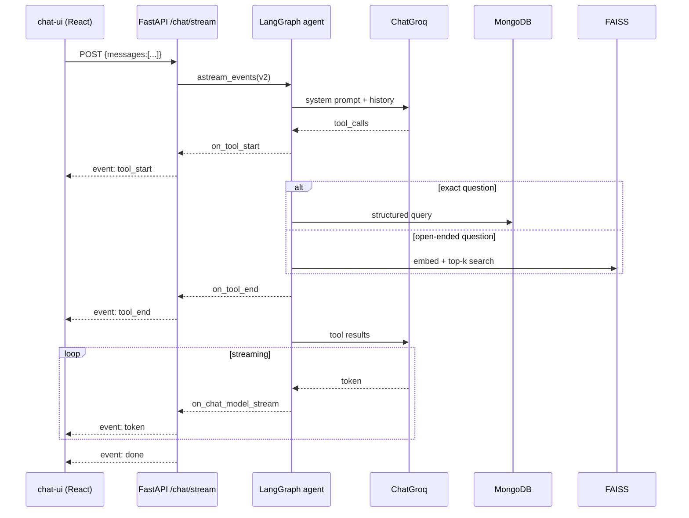
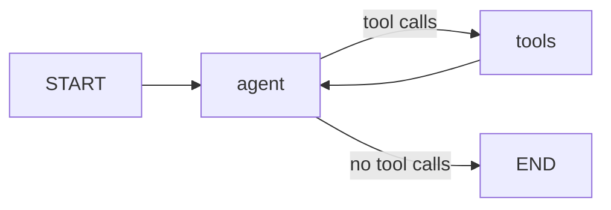

# Architecture

Companion to [plan.md](plan.md). This records *why* the system is shaped the way it
is; the README covers how to run it.

---

## 1. Request flow



## 2. Agent graph



`tools_condition` routes to `END` when the model returns no tool calls, so no
explicit `agent → END` edge is needed. The previous implementation declared both a
conditional edge and an unconditional `chatbot → END`, which made the intent
ambiguous.

The loop is capped by `recursion_limit = MAX_TOOL_ITERATIONS * 2 + 2` — two graph
steps per tool round trip, plus room for the final answer.

---

## 3. Decision records

### DR-1 — MongoDB replaces PostgreSQL

**Context.** The original store was a Postgres table with four columns:
`id, ProductName, Price, amount`.

**Problem.** Nothing to embed. A vector index over 20 bare product names adds nothing
over `ILIKE '%term%'`, and calling it RAG would be a stretch.

**Decision.** Point at the Banchan Atlas cluster, which already holds prose
descriptions, the 14-value UK allergen enum, four dietary flags, categories, calories,
prep times, and restaurant operating data.

**Consequences.** Real retrieval becomes possible; two projects share one data source;
`asyncpg` is dropped. Requires a read-only Atlas user — the assistant must never hold
write credentials to live restaurant data.

### DR-2 — Hybrid retrieval, not retrieval-only

**Context.** Vector search over the menu is now possible.

**Problem.** Vector search is the *wrong* mechanism for a large share of real
questions. Numeric predicates ("under £6") cannot be expressed as similarity. Exact
membership ("contains sesame") must not be approximated.

**Decision.** Two parallel tool families over overlapping subject matter, with routing
rules in the system prompt. Structured tools return authoritative values; semantic
search handles fuzzy, explanatory and comparative questions.

**Consequences.** More tools, so the routing has to be explicit or the model reaches
for whichever name looks closest to the user's wording. In exchange, the system gives
exact answers where exactness matters and graceful ones where it does not.

### DR-3 — Allergen queries never touch semantic search

**Context.** Allergen questions are the highest-stakes traffic the assistant handles.

**Decision.** `filter_menu` filters on the structured `allergens` array with `$nin`.
The system prompt forbids answering allergen questions from descriptions, from
`search_knowledge`, or from the model's own knowledge. An allergen the tool does not
recognise is **rejected**, not ignored — silently dropping an unknown term would
return dishes that contain it. Every allergen-filtered result carries a
cross-contamination warning.

**Consequences.** Some questions get a clarifying question instead of an answer. That
is the correct trade.

### DR-4 — FAISS rather than Atlas Vector Search

**Context.** The data already lives in Atlas, which has native vector search.

**Decision.** FAISS.

**Rationale.** The knowledge corpus is local markdown and would otherwise need
uploading to Atlas purely to be searchable; retrieval stays available when the
database is not; it works on the free tier without cluster-side configuration; and it
matches the project's stated stack. At ~40 chunks the index is trivially in-memory.

**Revisit if** the corpus grows past a few thousand chunks, or per-user documents
arrive, at which point Atlas Vector Search removes the rebuild-and-redeploy step.

### DR-5 — Embedding provider is pluggable

**Context.** OpenAI embeddings cost money and need a key; local ones are free but
install ~2 GB of torch.

**Decision.** One `EmbeddingProvider` protocol, two implementations, selected by
config. `sentence-transformers` is imported lazily and left out of
`requirements.txt`, so an OpenAI-only deployment never pays for it.

**The failure mode this creates:** an index built with one provider queried under
another. Where dimensions differ, FAISS throws something inscrutable; where they
match, it returns confident nonsense. So the index carries a `meta.json` recording
provider, model and dimension, and `VectorStore.load` refuses a mismatch with a
message telling you to rebuild. Two tests cover both cases.

### DR-6 — SSE with an in-band error event

**Context.** Token streaming means committing HTTP 200 before the work succeeds.

**Decision.** Five event types, `done` and `error` both terminal. Failures after the
stream opens are emitted as `error` rather than raised.

**Rationale.** Once the status line is sent, an exception cannot become a 500. Without
an in-band error the client waits indefinitely for a `done` that never arrives — a
hung UI rather than a visible failure.

Also: `X-Accel-Buffering: no`, because nginx and several PaaS proxies buffer
responses by default and would hold every token back until the stream ended.

### DR-7 — Full conversation history is sent to the agent

**Context.** The previous server extracted only the last user message.

**Problem.** No memory. "Is *that one* vegan?" was unanswerable.

**Decision.** The client sends the whole conversation; `to_langchain_messages`
converts user and assistant turns. Client-supplied `system` turns are dropped — the
system prompt is server-owned, which also closes a prompt-injection path.

### DR-8 — Degrade rather than refuse to boot

**Context.** Startup depends on Mongo and on a built index.

**Decision.** Both failures are logged, not fatal. `/health` reports
`mongo_connected`, `index_loaded`, `index_chunks` and the active embedding provider.
Tools that cannot work say so in their return value, which the model can relay.

**Rationale.** A service answering half its questions beats one that will not start,
and the health endpoint makes the degradation legible.

---

## 4. Retrieval pipeline

```
MongoDB menuitems ──▶ MenuItem.to_passage()  ─┐
MongoDB restaurants ─▶ Restaurant.to_passage()─┤
                                               ├─▶ Chunk[] ─▶ embed ─▶ FAISS IndexFlatIP
data/knowledge/*.md ─▶ RecursiveCharacter    ─┘                        + chunks.json
                       TextSplitter                                    + meta.json
                       (500 / 50 overlap)
```

Menu passages are **not** split: they are short and self-contained, and splitting
would strand a price away from its dish name. Knowledge markdown is split on heading
and paragraph boundaries first, so chunks rarely cut mid-sentence.

Every chunk carries `type` and `source`, which lets the retriever scope a search
(`doc_type=`) and lets the model cite where an answer came from.

---

## 5. Testing strategy

No test calls a real LLM, embedding API, or database.

| Fake | Replaces | Why |
|---|---|---|
| `FakeEmbeddingProvider` | OpenAI / sentence-transformers | Deterministic hashed bag-of-words: texts sharing vocabulary land near each other, so ranking assertions are stable and free |
| `FakeGraph` | The compiled agent | Emits real `astream_events(v2)` event shapes, so the SSE route is tested against the contract it consumes, independent of model behaviour |
| `FakeRepo` | `MenuRepository` | Records call arguments, so *routing* is assertable — e.g. that an unknown allergen never reaches the database |

The SSE tests parse the wire format by hand rather than using a client library, so
they genuinely assert well-formed framing.

---

## 6. Known limitations

1. **No persistent conversation state.** History round-trips through the client, so it
   is bounded by the request body and lost on refresh. A LangGraph checkpointer with
   thread IDs would be the fix.
2. **The index is a build artifact.** A menu change in Atlas is invisible until
   `build_index` reruns. Fine at this size; a scheduled rebuild or Atlas Vector Search
   would fix it.
3. **No auth or rate limiting.** The endpoints are open. Anyone with the URL can spend
   your Groq quota.
4. **`search_knowledge` embeds synchronously** inside the async handler. At top-k over
   tens of chunks the blocking window is negligible; at scale it needs a thread.
5. **Retrieval quality is untested against a labelled set.** There is no
   precision/recall measurement, so "is retrieval good" is currently a judgement call.
